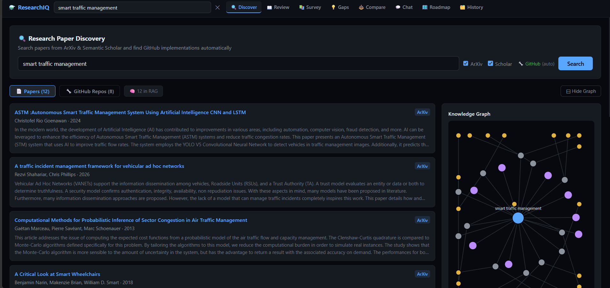
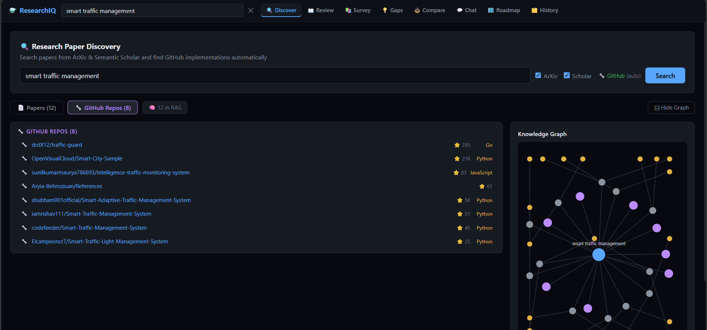
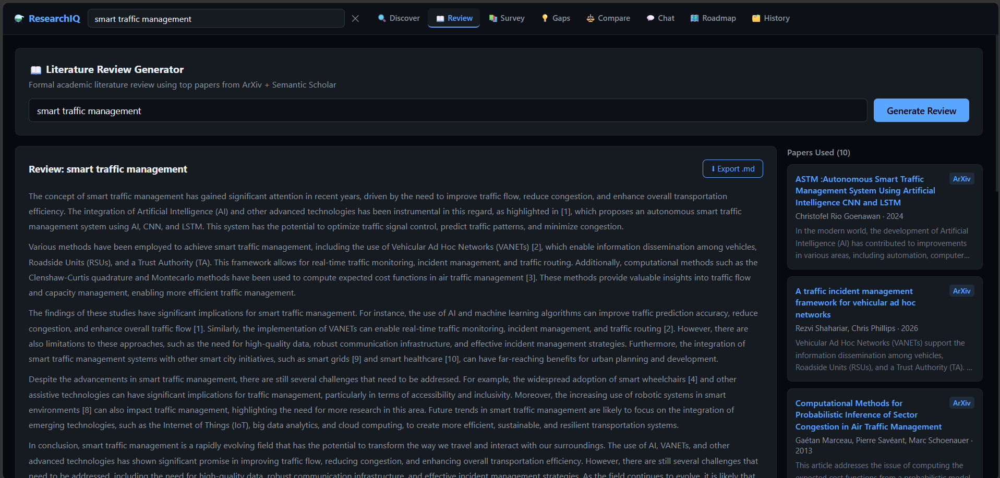
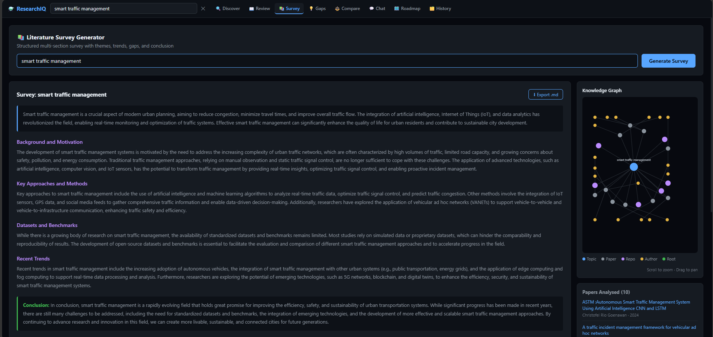
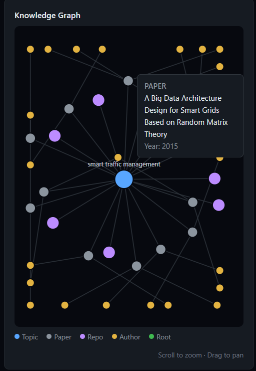
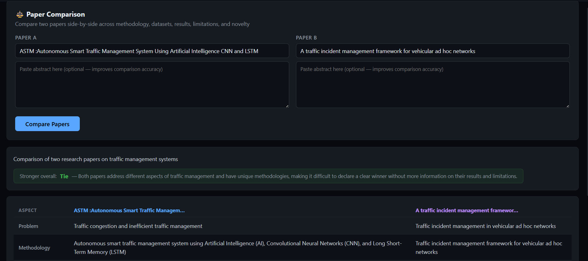
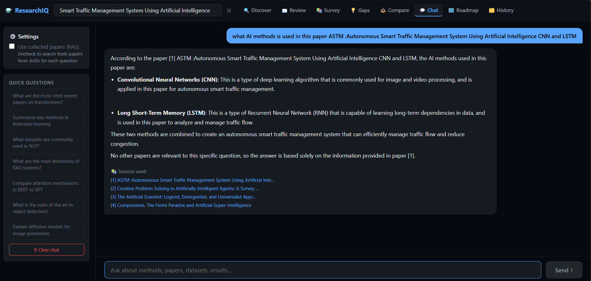

# 🔬 ResearchIQ: MCP-Powered Research Intelligence Platform with Neo4j


ResearchIQ is a MCP-powered Research Intelligence Platform that enables researchers, students, and developers to discover, analyze, compare, and understand academic literature using AI and native **Neo4j NoSQL Graph Database** persistence.

The platform leverages the **Model Context Protocol (MCP)** to connect Large Language Models with external research systems such as **ArXiv**, **Semantic Scholar**, **CrossRef**, **PubMed**, and **GitHub**, allowing the AI agent to retrieve real-time research knowledge before generating insights.

By combining MCP servers, Retrieval-Augmented Generation (RAG), Knowledge Graphs, Groq-powered LLMs, and a native **Neo4j Graph Database**, ResearchIQ transforms scattered research information into actionable, interconnected graph intelligence through a single unified interface.

---

# 🚀 Features

### 🔍 Multi-Source Research Discovery

Search across multiple research ecosystems simultaneously:

* ArXiv
* Semantic Scholar
* CrossRef (DOI metadata and reference lists)
* PubMed (biomedical literature)
* GitHub Repositories

Features:

* Parallel retrieval
* Paper deduplication
* Metadata enrichment
* Repository discovery
* Unified search experience

---

### 🔌 MCP-Powered Tool Calling

ResearchIQ uses MCP servers to expose external research systems as AI-accessible tools.

Connected MCP Servers:

| MCP Server           | Purpose                              |
| -------------------- | ------------------------------------ |
| ArXiv MCP            | Research paper discovery             |
| Semantic Scholar MCP | Citation and metadata retrieval      |
| GitHub MCP           | Open-source implementation discovery |
| CrossRef MCP         | DOI search and citation resolution   |
| PubMed MCP           | Biomedical search via NCBI Entrez    |

When ArXiv and Semantic Scholar return too few papers for a review, survey or gap analysis, the agent tops the list up from CrossRef and PubMed.

Benefits:

* Real-time information retrieval
* Tool-augmented reasoning
* Reduced hallucinations
* Source-grounded outputs
* Extensible architecture

---

### 📊 Neo4j NoSQL Graph Database Persistence

All research interactions, papers, authors, topics, repositories, searches, and generated reports are stored as a highly-connected knowledge graph in **Neo4j**:

* **Paper Nodes**: Stores title, abstract, year, citations, url, and arxiv ID.
* **Author Nodes**: Represents researchers and links via `[:AUTHORED]` to papers.
* **Topic Nodes**: Groups research domains, papers link in via `[:BELONGS_TO]` and reports via `[:COVERS_TOPIC]`.
* **Repository Nodes**: Tracks open-source implementations linked via `[:IMPLEMENTS]` and `[:FOUND_REPO]`.
* **Citation Edges**: `[:CITES]` between papers, used by PageRank and the depth-controlled subgraph view.
* **Search & Report Nodes**: Maintains a history of queries and AI synthesis reports connected to their referenced artifacts.

---

### 📚 Literature Review Generator

Automatically generates structured academic literature reviews.

Outputs include:

* Research Background
* Existing Approaches
* Comparative Analysis
* Key Findings
* Limitations
* Future Directions

Powered by Groq Llama 3.3 70B.

---

### 📝 Research Survey Generator

Create comprehensive surveys covering:

* Introduction
* Background
* State of the Art
* Key Methods
* Datasets
* Evaluation Metrics
* Current Trends
* Conclusion

---

### 🎯 Research Gap Detection

Identify:

* Underexplored problems
* Missing evaluations
* Dataset limitations
* Novel opportunities
* Future research directions

---

### 🌐 Interactive Knowledge Graph

Visualize relationships among:

* Papers
* Authors
* Topics
* Citations
* Repositories

Built using D3.js, NetworkX, and Neo4j graph queries.

---

### ⚖️ Paper Comparison Engine

Compare research papers across:

* Problem Statement
* Methodology
* Dataset
* Results
* Novel Contributions
* Limitations

Ideal for literature analysis and academic reviews.

---

### 💬 Chat with Papers

Ask natural language questions about research papers.

Capabilities:

* Context-aware responses
* Paper-grounded reasoning
* Research assistance
* Citation-based answers

Powered by Retrieval-Augmented Generation (RAG).

---

### 🗺️ Research Roadmap Generator

Generate personalized learning roadmaps:

1. Foundations
2. Core Concepts
3. Advanced Topics
4. Research Contributions

Includes relevant papers and implementation repositories.

---

### 🗄️ Research History & Analytics

Stores:

* Searches
* Literature Reviews
* Surveys
* Gap Reports
* Learning Roadmaps

using native **Neo4j Graph Database** persistence with automatic in-memory fallback support.

The Analytics tab shows live node and relationship counts, heap usage, index advice from `/api/db/health`, and a latency benchmark that times each graph query endpoint from the browser.

---

# 🎯 Why MCP?

Traditional AI research assistants rely on static model knowledge and quickly become outdated.

ResearchIQ adopts the **Model Context Protocol (MCP)**, enabling AI agents to interact with live research systems as external tools.

Benefits of MCP:

✅ Real-time paper retrieval

✅ Access to latest publications

✅ Citation-aware reasoning

✅ Repository discovery

✅ Extensible architecture

✅ Reduced hallucinations

✅ Research-grounded outputs

This makes ResearchIQ a true AI research copilot rather than a simple paper summarization system.

---

# 🏗️ Architecture

```text
                              User Query
                                   │
                                   ▼
       ┌──────────────────────────────────────────────────────┐
       │              React Frontend (Vite + D3)              │
       │  Discover · Review · Survey · Gaps · Compare · Chat  │
       │          Roadmap · History · Analytics               │
       └───────────────────────────┬──────────────────────────┘
                                   │  /api/*
                                   ▼
       ┌──────────────────────────────────────────────────────┐
       │                   FastAPI Backend                    │
       │  search / review / survey / gaps / chat / roadmap    │
       │  CRUD · domain queries · subgraph export · health    │
       └──────┬──────────────────────┬────────────────┬───────┘
              │                      │                │
              ▼                      ▼                ▼
   ┌────────────────────┐  ┌──────────────────┐  ┌───────────────────────┐
   │ Research AI Agent  │  │   MCP Servers    │  │  Graph Layer (db/)    │
   │ Groq Llama 3.3 70B │  │ ArXiv · Semantic │  │ crud.py    CRUD       │
   │ reviews, surveys,  │  │ Scholar · GitHub │  │ queries.py 14 queries │
   │ gaps, chat         │  │ CrossRef · PubMed│  │  PageRank, Louvain,   │
   └─────────┬──────────┘  └────────┬─────────┘  │  TTL cache, APOC      │
             │                      │            │ health.py diagnostics │
             ▼                      ▼            └───────────┬───────────┘
   ┌────────────────────┐  ┌──────────────────┐              │ bolt :7687
   │ Knowledge Graph    │  │ RAG Store        │  ┌───────────▼───────────┐
   │ (NetworkX)         │  │ keyword context  │  │ Neo4j 5.18 Community  │
   └────────────────────┘  └──────────────────┘  │ + APOC core           │
                                                 └───────────────────────┘

        Reviews • Surveys • Gaps • Chat • Roadmaps • Graph Analytics
```

---

# 🕸️ Neo4j Graph Data Model

```text
   (:Author) ──[:AUTHORED]──► (:Paper) ──[:BELONGS_TO]──► (:Topic)
                               │    ▲
                      [:CITES] │    │ [:IMPLEMENTS]
                               ▼    │
                         (:Paper)  (:Repository)

   (:Search) ──[:FOUND_PAPER]────► (:Paper)
   (:Search) ──[:FOUND_REPO]─────► (:Repository)
   (:Report) ──[:INCLUDES_PAPER]─► (:Paper)
   (:Report) ──[:INCLUDES_REPO]──► (:Repository)
   (:Report) ──[:COVERS_TOPIC]───► (:Topic)
```

### Useful Cypher Queries:

* **Find Top Authors in Knowledge Base**:
  ```cypher
  MATCH (a:Author)-[:AUTHORED]->(p:Paper)
  RETURN a.name AS author, count(p) AS papers_authored
  ORDER BY papers_authored DESC LIMIT 10;
  ```

* **Find Papers connected to a Topic**:
  ```cypher
  MATCH (p:Paper)-[:BELONGS_TO]->(t:Topic {name: "Graph Neural Networks"})
  RETURN p.title, p.year, p.citations ORDER BY p.citations DESC;
  ```

* **Inspect Reports & Connected Artifacts**:
  ```cypher
  MATCH (r:Report)-[:INCLUDES_PAPER]->(p:Paper)
  RETURN r.topic, r.report_type, collect(p.title) AS papers;
  ```

---

# 🔄 Research Workflow

```text
Research Topic
      │
      ▼
MCP-Based Paper Discovery
(ArXiv + Semantic Scholar + GitHub)
      │
      ▼
Aggregation & Deduplication
      │
      ▼
Knowledge Graph Construction
      │
      ▼
RAG Context Creation
      │
      ▼
Groq LLM Analysis
      │
      ▼
Review / Survey / Gap Detection
      │
      ▼
Neo4j Graph Database Persistence
      │
      ▼
Interactive Insights & Graph Analytics
```

---

# 📸 Screenshots

## 🏠 Research Discovery



---

## 📦 GitHub Repository Discovery



---

## 📚 Literature Review Generator



---

## 📄 Research Survey Generation



---

## 🌐 Knowledge Graph Visualization



---

## ⚖️ Paper Comparison



---

## 💬 Chat with Papers



---

# 🛠️ Tech Stack

| Component        | Technology                          |
| ---------------- | ----------------------------------- |
| Frontend         | React, Vite                         |
| Backend          | FastAPI                             |
| Language         | Python                              |
| LLM              | Llama 3.3 70B                       |
| Inference        | Groq                                |
| Protocol         | Model Context Protocol (MCP)        |
| Knowledge Graph  | NetworkX                            |
| Visualization    | D3.js                               |
| Database (NoSQL) | **Neo4j Graph Database** (Cypher)   |
| APIs             | ArXiv, Semantic Scholar, GitHub, CrossRef, PubMed |
| Graph Algorithms | PageRank (Cypher), Louvain (NetworkX) |
| Async Processing | aiohttp                             |
| Validation       | Pydantic                            |
| RAG Engine       | Custom Context Retrieval            |

---

# 📂 Project Structure

```text
research-intelligence-platform/
│
├── backend/
│   ├── app/
│   │   ├── api/
│   │   │   └── routes.py
│   │   ├── agents/
│   │   │   └── research_agent.py
│   │   ├── mcp/
│   │   │   ├── arxiv.py
│   │   │   ├── semantic_scholar.py
│   │   │   ├── github.py
│   │   │   ├── crossref.py
│   │   │   └── pubmed.py
│   │   │
│   │   ├── services/
│   │   │   └── graph.py
│   │   ├── rag/
│   │   │   └── vectorstore.py
│   │   └── db/
│   │       ├── database.py
│   │       ├── neo4j_client.py
│   │       ├── crud.py
│   │       ├── queries.py
│   │       └── health.py
│   │
│   └── requirements.txt
│
├── frontend/
│   ├── src/
│   │   ├── components/
│   │   ├── pages/
│   │   └── services/
│   │
│   └── package.json
│
├── screenshots/
│   ├── home-discover.png
│   ├── github-repo-discover.png
│   ├── literature-review-generator.png
│   ├── survey.png
│   ├── graph.png
│   ├── paper-compare.png
│   └── chat.png
│
├── scripts/
│   ├── ingest_live.py
│   ├── benchmark_queries.py
│   ├── backup_restore.py
│   ├── export_cypher.cql
│   └── query_evidence.json
│
├── tests/
│   ├── test_neo4j_queries.py
│   └── test_graph_algorithms.py
│
├── docker-compose.yml
├── run.py
├── README.md
├── requirements.txt
├── .env.example
└── .gitignore
```

---

# ⚙️ Installation & Setup

## 1️⃣ Clone Repository

```bash
git clone https://github.com/ramnnn2006/research-intelligence.git

cd research-intelligence
```

---

## 2️⃣ Start Neo4j Graph Database (Docker)

Start Neo4j Community Edition using Docker Compose:

```bash
docker-compose up -d
```

* **Neo4j Browser**: `http://localhost:7474`
* **Bolt Protocol**: `bolt://localhost:7687`
* **Default Credentials**: Username `neo4j`, Password `research123`

*(Note: If Neo4j is not running, the application gracefully operates using built-in in-memory fallback storage).*

---

## 3️⃣ Create Virtual Environment

### Windows

```bash
python -m venv venv

venv\Scripts\activate
```

### Linux / macOS

```bash
python3 -m venv venv

source venv/bin/activate
```

---

## 4️⃣ Install Backend Dependencies

```bash
pip install -r backend/requirements.txt
```

---

## 5️⃣ Install Frontend Dependencies

```bash
cd frontend

npm install

npm run build

cd ..
```

---

## 6️⃣ Configure Environment Variables

Create a `.env` file from the example template:

```bash
cp .env.example .env
```

Set your keys in `.env`:

```env
GROQ_API_KEY=your_groq_api_key
NEO4J_URI=bolt://localhost:7687
NEO4J_USER=neo4j
NEO4J_PASSWORD=research123
NEO4J_DATABASE=neo4j
GITHUB_TOKEN=optional
NCBI_API_KEY=optional       # PubMed, raises the limit from 3 to 10 requests/sec
CROSSREF_MAILTO=optional    # contact email, gets CrossRef's faster pool
```

Get a free Groq API key from:
https://console.groq.com

---

## 7️⃣ Run the Application

```bash
python run.py
```

Open:

```text
http://127.0.0.1:8000
```

---

# 💡 Example Use Cases

```text
Generate a literature review on Retrieval-Augmented Generation
```

```text
Find research gaps in Multimodal Large Language Models
```

```text
Compare Vision Transformers and CNN-based architectures
```

```text
Generate a survey on Graph Neural Networks
```

```text
Create a research roadmap for Reinforcement Learning
```

```text
Find GitHub implementations related to Diffusion Models
```

---

# 🎯 Future Enhancements

* Persistent Vector Database
* PDF Research Assistant
* Multi-Agent Research Workflows
* Zotero Integration
* Semantic Search
* BibTeX Export
* LaTeX Report Generation
* Research Recommendation Engine

---

---

# 🗄️ Graph Database Architecture & Analytics Engine

ResearchIQ integrates a native Neo4j property graph database to model academic literature, citations, authors, topics, and code repositories. The database engine provides graph algorithms, multi-source ingestion connectors, depth-controlled subgraph export, automated health monitoring, and backup tooling.

### Core Database Capabilities

| Area | Implementation Details | Key Components |
| :--- | :--- | :--- |
| Graph Algorithms | PageRank citation centrality, Louvain community detection, modularity scoring | `backend/app/db/queries.py` |
| Metadata Connectors | CrossRef (DOI search, reference resolution) and PubMed (NCBI E-utilities) | `backend/app/mcp/crossref.py`, `pubmed.py` |
| Subgraph Export | JSON and CSV downloads of citation, author, or topic subgraphs (1 to 3 hops) | `GET /api/graph/export/json`, `/csv` |
| Health Diagnostics | Live Neo4j connection pool status, label counts, memory heap, index advisor | `GET /api/db/health`, `backend/app/db/health.py` |
| Visual Analytics | Interactive D3 citation graph with depth slider and system health dashboard | `Graph.jsx`, `Discover.jsx`, `Analytics.jsx` |
| Query Optimization | LRU caching with TTL for multi-hop traversals, APOC path expansion fallbacks | `backend/app/db/queries.py` |
| Data Operations | Automated snapshot backup, restore, and graph integrity verification CLI | `scripts/backup_restore.py` |
| Test Coverage | Comprehensive unit tests covering graph algorithms, queries, and health endpoints | `tests/test_graph_algorithms.py` |

---

### Graph Schema (as implemented)

Neo4j 5.18 Community Edition with the APOC core plugin.

| Label | Unique key | Other properties |
| :--- | :--- | :--- |
| `Paper` | `id` | `arxiv_id`, `title`, `abstract`, `year`, `url`, `source`, `citations`, `created_at`, `pagerank`, `community` |
| `Author` | `name` | |
| `Topic` | `name` | |
| `Repository` | `name` | `url`, `stars`, `description` |
| `Search` | `id` | `query`, `created_at` |
| `Report` | `id` | `topic`, `report_type`, `content`, `created_at` |

`pagerank` and `community` are written by the algorithms below, every other property comes from ingestion.

```text
(:Author)-[:AUTHORED]->(:Paper)
(:Paper)-[:BELONGS_TO]->(:Topic)
(:Paper)-[:CITES]->(:Paper)
(:Repository)-[:IMPLEMENTS]->(:Paper)
(:Search)-[:FOUND_PAPER]->(:Paper)       (:Search)-[:FOUND_REPO]->(:Repository)
(:Report)-[:INCLUDES_PAPER]->(:Paper)    (:Report)-[:INCLUDES_REPO]->(:Repository)
(:Report)-[:COVERS_TOPIC]->(:Topic)
```

Constraints and indexes are created on startup by `neo4j_client.init_schema()`. The standalone version, including the indexes recommended for the algorithm properties, is in `scripts/export_cypher.cql`.

---

### Cypher CRUD Operations API

| Operation | Endpoint | Cypher Pattern |
| :--- | :--- | :--- |
| Create | `POST /api/db/crud/create` | `MERGE (p:Paper {id: $id}) ON CREATE SET ...` |
| Read | `GET /api/db/crud/read/{id}` | `MATCH (p:Paper {id: $id}) OPTIONAL MATCH (a)-[:AUTHORED]->(p) RETURN ...` |
| Update | `PUT /api/db/crud/update` | `MATCH (p:Paper {id: $id}) SET p.citations = $citations RETURN ...` |
| Delete | `DELETE /api/db/crud/delete/{id}` | `MATCH (p:Paper {id: $id}) DETACH DELETE p` |

---

### Query Catalog

Everything lives in `backend/app/db/queries.py`. Queries without an endpoint are run by `scripts/benchmark_queries.py` and the tests.

| # | Query | Kind | Exposed at |
| :--- | :--- | :--- | :--- |
| 1 | Multi-hop citation paths (2 hops) | traversal, cached | benchmark script |
| 2 | Co-authorship network | pattern match | `GET /api/db/queries/coauthorship` |
| 3 | Paper to code matching | cross-label traversal | `GET /api/db/queries/paper-code` |
| 4 | Landmark papers by in-degree | degree count, cached | `GET /api/db/queries/indegree-centrality` |
| 5 | Topic subgraph context for the LLM | traversal | benchmark script |
| 6 | Cross-topic research gaps | cross-citation density | `GET /api/db/queries/research-gaps` |
| 7 | Search history with discovered papers | audit trail | benchmark script |
| 8 | Report grounding verification | provenance | benchmark script |
| 9 | Topic citation distribution | aggregation | `GET /api/db/queries/topic-distribution` |
| 10 | Author productivity ranking | aggregation | `GET /api/db/queries/author-productivity` |
| 11 | Citation PageRank | iterative algorithm | `compute_citation_pagerank()` |
| 12 | Louvain paper communities | algorithm | `detect_paper_communities()` |
| 13 | Community modularity | aggregation | `get_community_modularity()` |
| 14 | Subgraph extraction for export | traversal, APOC or Cypher, cached | `GET /api/graph/export/json`, `/csv` |
| | Execution plan inspection | `EXPLAIN` | `POST /api/db/queries/explain` |

---

### Graph Algorithms

Community Edition doesn't ship the Graph Data Science library, so both algorithms are built from plain Cypher plus a little Python.

PageRank (`compute_citation_pagerank`) starts every paper at `1/N`. Each pass is two Cypher statements: the first computes `(1 - d)/N + d * sum(rank(src) / outdegree(src))` over incoming `:CITES` into `p.pagerank_next`, the second swaps it into `p.pagerank` and returns the total change. It stops after 20 passes or once the change drops below `1e-4`. Damping is 0.85. Papers that are cited by other well cited papers end up on top, which is the landmark signal in-degree alone misses.

Louvain communities (`detect_paper_communities`) treat two papers as linked when one cites the other or when they share an author, weighted by how many such links exist. Cypher pulls that weighted edge list, NetworkX runs `louvain_communities` (seed 42 so ids stay stable), and the result is written back as `p.community`, largest community first. Query 13 then recomputes modularity in Cypher from the stored labels, so the number you see is from the database and not from NetworkX.

```bash
cd backend
python -c "from app.db.queries import compute_citation_pagerank as pr; print(pr(limit=5))"
python -c "from app.db.queries import detect_paper_communities as dc; print(dc(limit=5))"
```

The database dump in `scripts/export_cypher.cql` contains 58 active `:CITES` edges and populated citation counts, enabling immediate non-flat PageRank calculation and community clustering upon initial loading.

---

### Subgraph Export

`GET /api/graph/export/json` and `GET /api/graph/export/csv` both return a file download (`Content-Disposition: attachment`).

| Param | Values | Meaning |
| :--- | :--- | :--- |
| `scope` | `citations`, `authors`, `topic` | which relationships to walk: `CITES`, `AUTHORED`, or all of `CITES/AUTHORED/IMPLEMENTS/BELONGS_TO` |
| `paper_id` | paper id | start from one paper |
| `topic` | text | start from papers in a matching topic or a matching past search |
| `depth` | 1 to 3 | number of hops |
| `limit` | 1 to 1000 | max relationships returned |
| `table` | `edges`, `nodes` | CSV only, edge list or node table |

With neither `paper_id` nor `topic` the 25 most cited papers are used as seeds. The JSON has the same `{nodes, links}` shape the D3 graph renders, which is how the depth slider on the Discover page works.

```bash
curl -OJ "http://127.0.0.1:8000/api/graph/export/csv?scope=topic&topic=Large%20Language%20Models&depth=2"
```

---

### Health Check API

`GET /api/db/health` reports:

* `status` and `latency_ms` (connect plus a ping round trip)
* `connection_pool`: URI, database and open server side connections per connector
* `nodes` and `relationships`: totals plus a breakdown per label and per type
* `indexes` and `constraints`: straight from `SHOW INDEXES` / `SHOW CONSTRAINTS`
* `memory`: JVM heap used, committed and max, via `dbms.queryJmx`
* `index_advice`: properties the query catalog filters or sorts on that no index covers, with the `CREATE INDEX` statement to fix it, and any index that isn't `ONLINE`

On the loaded snapshot it came back healthy in about 7 ms, 192 nodes, 240 relationships, 160 MB of a 1 GB heap, and it suggested indexes on `Paper.citations`, `Paper.pagerank`, `Paper.community`, `Repository.stars` and `Search.query`. The Analytics tab in the frontend is built on this endpoint plus `/api/db/stats`.

---

### Query Cache and APOC

The multi-hop queries (1, 4 and 14) go through a small LRU cache with a 120 second TTL. Results are only cached while Neo4j is connected, so an outage never leaves empty results stuck in it. On the snapshot a 2-hop topic subgraph takes about 60 ms cold and well under a millisecond from cache.

When APOC is installed (the `docker-compose.yml` already enables it) subgraph export uses `apoc.path.subgraphAll`, which visits each node once. Without APOC it falls back to variable-length Cypher, which enumerates paths and gets expensive at 3 hops. Both return the same nodes and links on the snapshot. In-degree counts use `COUNT { (p)<-[:CITES]-(:Paper) }`, which reads the node's degree instead of expanding a row per citing paper.

---

### Backup, Restore and Integrity Checks

```bash
python scripts/backup_restore.py --backup                 # backups/graph_backup_<timestamp>.json
python scripts/backup_restore.py --restore backups/graph_backup_20261008_211827.json
python scripts/backup_restore.py --verify
```

The backup holds every node with its labels and properties, every relationship and the constraint list. Restore merges nodes on their unique key, so running it against a live graph doesn't create duplicates.

`--verify` fails (exit 1) on `:CITES` edges that don't join two distinct papers with ids, nodes missing their key property, untitled papers, or duplicate constraints. Orphaned nodes and missing constraints are printed as warnings. Exit code 2 means Neo4j could not be reached.

---

### Quickstart & Execution Guide

```bash
# 1. Neo4j with APOC
docker compose up -d neo4j

# 2. Python deps (pytest and httpx are only needed for the tests)
pip install -r backend/requirements.txt pytest httpx

# 3. Load the snapshot, optionally pull fresh data
docker exec -i research_neo4j cypher-shell -u neo4j -p research123 < scripts/export_cypher.cql
python scripts/ingest_live.py

# 4. Check everything
pytest tests/                                  # 18 tests, needs the running database
python scripts/backup_restore.py --verify
python scripts/benchmark_queries.py           # writes scripts/query_evidence.json

# 5. Start the app
python run.py
```

---

⭐ If you found this project useful, consider giving it a star.

